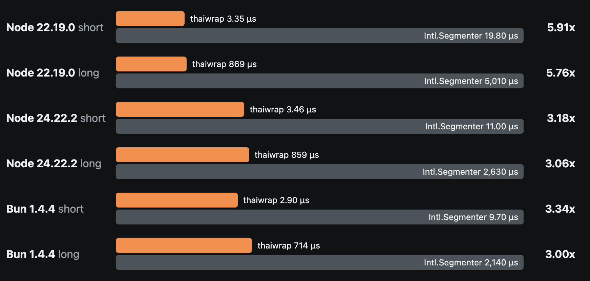

# thaiwrap

[](https://www.npmjs.com/package/thaiwrap)
[](LICENSE)

Fast Thai line wrapping for Node.js and Bun, powered by Rust.

`thaiwrap` breaks Thai text into lines of a maximum length **at word boundaries**, so Thai words are not cut in half; a word longer than the line is cut only where Thai rules allow.
No line starts with an orphan vowel or tone mark.

> **Status:** v0.x. The API is small and documented here, but it may still change before 1.0.
> Changes are recorded in the [changelog](CHANGELOG.md).

## Why

Thai is written without spaces between words. Slicing a string every N characters cuts words apart and can separate a consonant from its vowel and tone marks:

```js
// Naive: slice every 10 characters
["กระบวนการส", "ื่อสาร ส่ง", "มอบ และสร้", "างคุณค่า"]
//              ^ line 2 starts with an orphan vowel mark, and line 4 with an orphan vowel
```

`thaiwrap` finds the places where a line may break, applies the Thai text rules, then fills each line greedily:

```js
wrapThai("กระบวนการสื่อสาร ส่งมอบ และสร้างคุณค่า", 10)
// ["กระบวนการ", "สื่อสาร", "ส่งมอบ และ", "สร้าง", "คุณค่า"]
```

## Install

```bash
npm install thaiwrap
# or
bun add thaiwrap
```

Prebuilt native binaries are installed automatically for supported platforms. No Rust toolchain is needed to use the package.

## Usage

```ts
import { wrapThai } from "thaiwrap";

const lines = wrapThai("กระบวนการสื่อสาร ส่งมอบ และสร้างคุณค่า", 10);

for (const line of lines) {
  console.log(line);
}
// กระบวนการ
// สื่อสาร
// ส่งมอบ และ
// สร้าง
// คุณค่า
```

### API

```ts
wrapThai(text: string, maxLength: number, options?: WrapOptions): string[]
```

| Parameter   | Type          | Description                                   |
| ----------- | ------------- | --------------------------------------------- |
| `text`      | `string`      | The text to wrap. Thai, Latin and mixed text are supported. |
| `maxLength` | `number`      | Maximum length of each line. Must be a positive integer. |
| `options`   | `WrapOptions` | Optional settings (see below).                |

The bundled type declarations need TypeScript 4.5 or newer.
Returns an array of lines.
Break spaces (spaces and ZWSP) at line edges are trimmed.
No-break spaces (U+00A0, U+2007, U+202F) are content.

Invalid input throws instead of crashing the process.
Wrong types throw `TypeError`: `text` is not a string, `maxLength` is not a number, or `options` is not an object.
Wrong values throw `RangeError`: `maxLength` is not an integer from 1 to `Number.MAX_SAFE_INTEGER`, or `measure` or `overflow` is not one of the listed values.

### Options

| Option     | Default        | Description |
| ---------- | -------------- | ----------- |
| `measure`  | `"codeUnits"`  | How line length is counted: `"codeUnits"` or `"graphemes"`. See [Measuring length](#measuring-length). |
| `overflow` | `"split"`      | What to do with a word longer than `maxLength`: `"split"` or `"keep"`. See [Long words](#long-words). |

## Line breaking rules

### Spaces

Spaces are break opportunities.
They are trimmed at line edges and kept inside a line.
A zero width space (U+200B) breaks like a space.
A no-break space (NBSP) never breaks.

### Line breaks

`\n`, `\r\n`, `\r`, VT, FF, NEL, U+2028, and U+2029 always end a line.

### Blank lines

An input line with no visible characters becomes `""`.
A wrapped piece with no visible characters is dropped, so `""` never appears inside one paragraph.
Blank lines before the first and after the last visible line are dropped.
Blank lines between visible lines are kept, not collapsed.

```js
wrapThai("", 10)            // []
wrapThai("   ", 10)         // []
wrapThai("\n\n", 10)        // []
wrapThai("ก\n\nข", 10)      // ["ก", "", "ข"]
wrapThai("\n\nก\n\n", 10)   // ["ก"]
wrapThai("ก\n\n\nข", 10)    // ["ก", "", "", "ข"]
```

### Long words

`overflow: "split"` (default) cuts a word longer than `maxLength` between Thai Character Clusters, the smallest groups of Thai letters that cannot be split apart (for example `เกี่ยว` is `เกี่ย` + `ว`).
Outside Thai, and inside a single cluster that is longer than `maxLength`, it cuts at grapheme boundaries.
Every cut still keeps Thai vowels and tone marks with their consonant.
`overflow: "keep"` puts the whole word on its own line.

A unit that cannot be cut is placed alone on its line, even when it is longer than `maxLength`.
For example, `ที่` is one grapheme of 3 code units, and `กา` cannot start a line with `า`.

For Thai text, use a `maxLength` of 5 or more.
Then a line is longer than `maxLength` only in rare cases, such as a word followed by repeated ๆ (`เท่าๆๆ` is one unit of 6 code units).

## Measuring length

By default, length is counted the same way as JavaScript's `String.prototype.length` (UTF-16 code units). Thai vowel and tone marks written above or below a consonant count as one unit each, even though they take no horizontal space on screen.

This matters for the result. The same input wrapped at 10 gives different lines depending on how length is counted:

```js
// Code units (default, same as .length)
["กระบวนการ", "สื่อสาร", "ส่งมอบ และ", "สร้าง", "คุณค่า"]

// Grapheme clusters (closer to what you see on screen)
["กระบวนการ", "สื่อสาร ส่ง", "มอบ และ", "สร้างคุณค่า"]
```

Use code units when you need to match a character limit (database columns, SMS, fixed-width fields).
Use `measure: "graphemes"` when you fit text into a space on screen (closer to what you see).

## How it works

1. Break opportunities come from [ICU4X](https://github.com/unicode-org/icu4x)'s dictionary-based line segmenter (Unicode UAX #14), which finds Thai word boundaries and keeps punctuation with its word.
   The segmenter is compiled into the native addon.
2. The Thai text rules remove break positions that would start a line with a combining mark or one of `ะ า ำ ๆ ฯ`, end it with a leading vowel, or fall next to a no-break character.
3. Units are placed on the current line until the next unit would exceed `maxLength`, then a new line starts.
4. Spaces at line edges are dropped.

Because the dictionary ships inside the package, output is the same on every runtime and does not depend on the ICU version bundled with your Node or Bun install.

## Performance

Numbers are microseconds per call. "Short" is the 36-character example above. "Long" is the same text repeated 300 times (about 11,000 characters).

The v0.1 build measures about 5.8-5.9x faster than an `Intl.Segmenter` wrapper on Node 22, about 3.1-3.2x on Node 24, and about 3.0-3.3x on Bun 1.4.4 (Apple M1 Pro, 2026-10-31, see [benchmarks](docs/m0/benchmarks.md)).
The wrapper is the reference used in the tests, which breaks at word boundaries.
It also applies the Thai rules per grapheme.
Against a plain word-break wrapper the gap was about 2.2-2.6x on Node 22, 1.5-1.8x on Node 24 and 2x on Bun.
The gain matters most for high-volume work such as generating receipts, labels or PDFs in bulk.
The chart below shows the v0.1 numbers (Apple M1 Pro, average time per call, lower is better).



More charts are on the [benchmark page](https://thaiwrap.eukron.com/benchmarks/).
Full documentation is on the [docs site](https://thaiwrap.eukron.com/docs/) (source in [`site/`](site)).

## Platform support

`thaiwrap` is a native Node-API addon built with [napi-rs](https://napi.rs).
Prebuilt binaries are provided for:

| OS      | Architectures       |
| ------- | ------------------- |
| Linux   | x64 (glibc), arm64 (glibc), x64 (musl) |
| macOS   | x64, arm64          |
| Windows | x64                 |

Runtimes: Node.js 22+ and Bun.
The Windows binary links the C runtime statically, so it needs no Visual C++ Redistributable.
On other platforms, loading the package throws an error that names your platform.

Not supported yet: browsers and edge runtimes such as Cloudflare Workers. A WebAssembly build may be added later.

## Known limitations

- Lone surrogates become U+FFFD.
- Invisible format characters (soft hyphen, LRM/RLM) are not looked through by the Thai rules.
- Output can differ from `Intl.Segmenter` because thaiwrap uses its own ICU4X dictionary and UAX #14 line breaking (for example it keeps `?` and `)` with the word before them).
- Unsupported scripts: Lao, Khmer and Burmese.
  The package ships Thai dictionary data only, so a run of Lao, Khmer or Burmese text between spaces is never broken at word boundaries.
  It stays on one line when it fits.
  When it is longer than `maxLength`, the default `overflow: "split"` cuts it at grapheme cluster boundaries, and `overflow: "keep"` leaves it whole on its own line.
- A split inside a long word can leave a single final consonant on a line (for example `สร้า` / `ง`).
- The same happens before punctuation that stays with the word.
  For example `wrapThai("ระบบเก็บเสียงดีมาก?", 10)` gives `["ระบบเก็บ", "เสียงดีมา", "ก?"]`.

## Development

Requirements: Rust (stable, pinned in `rust-toolchain.toml`), Node.js 22+, Bun.

```bash
git clone https://github.com/theerakarnm/wrapthai.git
cd wrapthai
bun install
bun run build   # build the native addon
```

Before every commit, run all four checks:

```bash
cargo fmt --all
cargo clippy --workspace --all-targets -- -D warnings
cargo test --workspace
bun run build && bun test
```

Benchmarks: `cargo bench -p thaiwrap-core`, `bun run bench`, `node bench/index.mjs`.

### Repository layout

| Path                   | Purpose |
| ---------------------- | ------- |
| `crates/thaiwrap-core` | Pure Rust segmentation and wrapping. All logic lives here. |
| `crates/thaiwrap-node` | Thin napi-rs binding. Converts types, validates input, maps errors. |
| `__test__/`            | JS tests, run against the built addon. |
| `corpus/`              | Test corpora, each with its own license. Never packaged. |
| `site/`                | Source of the docs site. |

## Contributing

Issues and pull requests are welcome. See also [CONTRIBUTING.md](CONTRIBUTING.md).
If a word is split in the wrong place, please open an issue with the input text, the `maxLength` you used, the output you got and the output you expected.

For code changes:

- Keep the example in [Why](#why) working. It is the acceptance test.
- Start bug fixes with a failing test.
- Use [Conventional Commits](https://www.conventionalcommits.org/) (`feat:`, `fix:`, `docs:`, ...).
- Open an issue first before adding a dependency or changing the public API.
- Update this README when public behavior or options change.
- Do not edit `CHANGELOG.md` by hand. It is generated by release-please.

See [AGENTS.md](AGENTS.md) for the full engineering rules, including the Thai text rules every change must keep.

## Security

See [SECURITY.md](SECURITY.md).

## Acknowledgements

Word boundaries come from [ICU4X](https://github.com/unicode-org/icu4x).
Long Thai words are split with the Thai Character Cluster rules of Theeramunkong et al. ("Character cluster based Thai information retrieval", IRAL 2000), as extended in [PyThaiNLP](https://github.com/PyThaiNLP/pythainlp) `tcc_p.py` (Apache-2.0).
The Node-API binding uses [napi-rs](https://napi.rs).

## License

[MIT](LICENSE).
The native binary embeds Unicode data from ICU4X (CLDR and ICU), licensed under the [Unicode License v3](LICENSE-UNICODE).
Test corpora under `corpus/` keep their own licenses.
